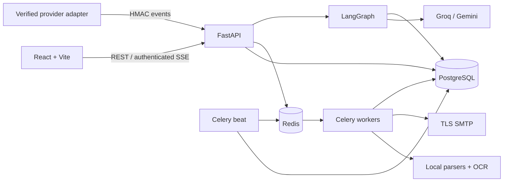

# Architecture and invariants

## System flow

## Tenant boundary

Every organization-owned entity contains an indexed organization foreign key. Ownership is checked before fetching attachments, campaigns, SMTP accounts, recipients, templates, or executions. User roles gate mutations and sensitive configuration; public registration creates a new independent organization with its own administrator. No endpoint accepts an organization ID to switch the authenticated tenant. Shared-workspace membership provisioning is currently an operator task; no invitation-email flow is implemented.

Passwords use Argon2. Access JWTs expire, include a version for global logout, and are distinct from unsubscribe tokens. Refresh secrets are stored only as SHA-256 hashes, rotated under a database row lock, and rejected after reuse. SMTP credentials are encrypted using the deployment's Fernet key. JWT/encryption keys are never returned by settings APIs.

Frontend session tokens live in tab-scoped sessionStorage. Enforce HTTPS and the shipped CSP in deployment. HTML email previews use sandboxed iframes with a restrictive document CSP; application HTML is never populated with email `dangerouslySetInnerHTML`. API-side bleach sanitization strips unsafe markup, links, attributes, and scripts. Personalization values are HTML-escaped and subject values have newline characters removed.

## Campaign approval

A campaign revision identifies its subject, body, selected recipients, personalization data, template assignment, and attachments. Human recipient review and successful dry-run validation record that revision. Changing the relevant draft content invalidates the preflight by incrementing the revision. The approval API:

1. Locks the campaign row.
2. Requires draft status, explicit `confirm: true`, and matching revision.
3. Checks reviewed and dry-run revisions.
4. Rejects production requests while server dry-run is enabled.
5. Requires a tested SMTP account.
6. Requires actual recipients, latest granted consent, and no suppression.
7. Checks CC/BCC consent and combined campaign/template attachment sizes.
8. Creates one immutable personalized message snapshot per recipient using a unique idempotency key.
9. Records attachment associations, queued events, schedule, and approval audit entry transactionally.

The periodic dispatcher reads committed PostgreSQL rows, so a broker outage between approval and publish does not lose a campaign. Duplicate Celery tasks are safe because the worker locks the campaign and message, checks the current state, and only transitions `queued` messages once. Lock order is consistent with campaign control endpoints.

Live changes to consent and suppression are rechecked before each delivery. Names, content, and attachments on already queued messages are snapshots. Campaigns that already have messages cannot be edited in place; duplicate them to create a new reviewable version.

## Delivery failure model

Temporary 4xx SMTP responses return a message to queued with exponential delay. Permanent errors become failed. Uncertain network outcomes and expired sending leases become uncertain and are never automatically retried. A campaign resolves to completed, partially completed, or failed when no queued/sending work remains. Cancellation preserves completed attempts. Acceptance, delivery, bounce, open, and click are different events.

The `List-Unsubscribe` link is signed and scoped to one organization/address. GET renders a confirmation form so link scanners do not unsubscribe a user merely by fetching the URL. POST suppresses the address and supports one-click unsubscribe semantics. Bounces from signed provider adapters also suppress the recipient.

## Agent execution

The LangGraph state carries a task, typed API payload, tenant identity, execution ID, result, and executed-step list. A central orchestrator selects a bounded node. Planning can transition into composition when the typed plan recommends preparing copy. Document extraction runs in a worker. Composition and analytics use structured LLM responses through LangChain provider integrations. Planning receives actual selected campaign data and deterministic batch/duplicate context; it cannot send. Delivery inspection reports actual queue outcomes. Agent nodes persist running/completed/failed status and log entries; transient connection failures have bounded retries.

The copilot can queue extraction for explicitly supplied document IDs, inspect actual failures, generate a plan, and persist an unapproved draft when composition returns safe copy. Recipient candidates still require manual review and selection. It does not implement unrestricted natural-language execution, arbitrary code, or automatic approval.

## Documents

Uploads enforce byte limits, extension allow-lists, detected MIME, archive decompression limits, and optional ClamAV INSTREAM scanning. Files use random private storage names with restrictive permissions; no raw storage path or public attachment URL is exposed. Parse workers use PyMuPDF, python-docx, pandas/openpyxl/xlrd, antiword, defusedxml, and Tesseract. Documents are data, never agent instructions or executable content. OCR has a per-image timeout and extraction tasks have worker time limits.

Spreadsheet/JSON columns named email, name/full name, company/organization, and position/title supply metadata. Free text addresses are extracted deterministically; names and organizations are not invented. Reviewers can correct fields. A scan status of `not_configured` is displayed honestly and must not be interpreted as a clean scan.

## Database

The initial immutable migration creates all 22 requested domain tables plus normalized group membership and refresh-session tables. Foreign keys, indexes, recipient/message/provider-event uniqueness, SQLAlchemy relationships, transactions, and recipient soft deletion are included. Database analytics use aggregate SQL rather than frontend counters. Daily charts group messages by creation day and their current status; they are not a historical event-time funnel.

## Operational boundaries

Current file storage uses a shared persistent volume. Multi-host deployments need a shared storage adapter or mounted storage plus backups. Secrets use environment configuration, not a cloud secret-manager driver. Provider delivery confirmation uses a generic signed adapter contract, not built-in Gmail inbox tracking. Test results and unavailable external credentials are documented separately. Capacity, deliverability, legal consent policies, and provider-specific sending limits require deployment-specific review.
